# dotfiles

[](https://github.com/kats76/dotfiles/actions/workflows/check.yml)

[Read in English](README.md)

Mi configuración de Arch Linux + Hyprland, gestionada con [chezmoi](https://www.chezmoi.io/). Una sola paleta y una sola fuente en todo: el gestor de ventanas, la barra, el lanzador, la terminal, el menú de salida y la pantalla de login.

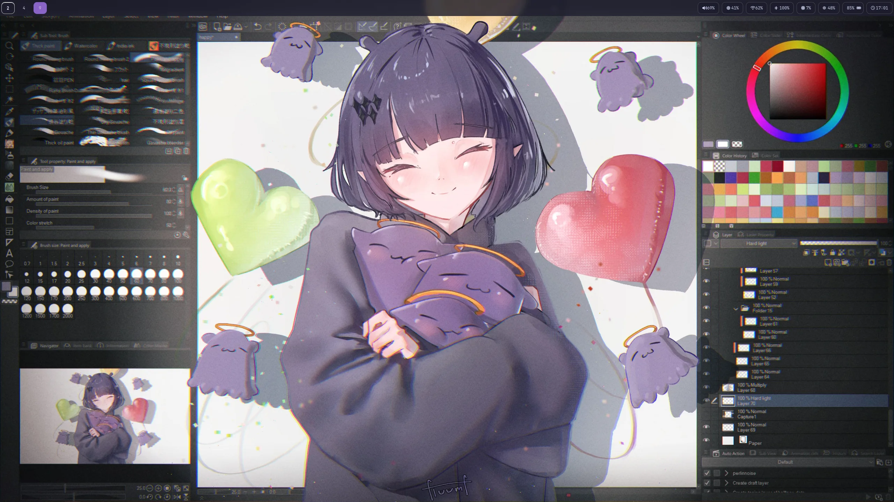

Este README también es una guía: cada componente tiene su captura, qué está configurado y qué cambiar para adaptarlo a tu equipo.

- [Instalación](#instalación-arch-linux)
- [Paleta y fuentes](#paleta-y-fuentes)
- [Hyprland](#hyprland) · [Waybar](#waybar) · [Pantalla de login](#pantalla-de-login-sddm) · [Menú de salida](#menú-de-salida-wlogout) · [Bloqueo](#bloqueo-e-inactividad) · [Lanzador](#lanzador-de-apps-wofi) · [Visor](#visor-de-imágenes-swayimg) · [Terminal y shell](#terminal-y-shell) · [Neovim](#neovim) · [Gestor de archivos y GTK](#gestor-de-archivos-y-gtk)
- [Flujo de trabajo](#flujo-de-trabajo) · [Nunca va al repo](#nunca-va-al-repo-) · [Otras máquinas](#otras-máquinas)

## Qué hay aquí

| Ruta en el repo | Destino en la máquina | Qué es |
| --- | --- | --- |
| `dot_config/hypr/` | `~/.config/hypr/` | Hyprland 0.57+ en Lua, wallpaper y el script de la tapa |
| `dot_config/waybar/` | `~/.config/waybar/` | Barra superior |
| `dot_config/sddm-silent/` | `~/.config/sddm-silent/` | Pantalla de login (tema SilentSDDM) y su instalador |
| `dot_config/wlogout/`, `wofi/`, `mako/` | `~/.config/…` | Menú de salida, lanzador de apps y notificaciones |
| `dot_config/kitty/`, `cava/`, `swayimg/` | `~/.config/…` | Terminal, visualizador de audio y visor de imágenes |
| `dot_config/nvim/` | `~/.config/nvim/` | Neovim con lazy.nvim y Catppuccin |
| `dot_config/fontconfig`, `gtk-3.0`, `gtk-4.0`, `qt6ct` | `~/.config/…` | Para que las apps GTK y Qt sigan el mismo estilo |
| `dot_local/share/color-schemes/` | `~/.local/share/color-schemes/` | Esquema de color de Qt con la paleta |
| `dot_zshrc`, `dot_bashrc` | `~/.zshrc`, `~/.bashrc` | Shell |

> Nomenclatura de chezmoi: `dot_` = `.`, `private_` = sin permisos para otros, `executable_` = ejecutable, `.tmpl` = plantilla.

## Instalación (Arch Linux)

Haz antes un `sudo pacman -Syu` completo: instalar un paquete de Qt con el sistema a medio actualizar rompe SDDM.

```bash
sudo pacman -S chezmoi hyprland hyprpaper waybar mako hyprlock hypridle swayimg kitty wofi cava brightnessctl playerctl \
  ttf-jetbrains-mono-nerd noto-fonts-emoji adobe-source-han-sans-jp-fonts qt6ct thunar starship \
  zsh-autosuggestions sddm qt6-virtualkeyboard blueman power-profiles-daemon
yay -S wlogout sddm-silent-theme
chezmoi init kats76
chezmoi diff        # revisar qué cambiaría
chezmoi apply
```

Las rutas del home son plantillas (`{{ .chezmoi.homeDir }}`), así que funciona con otro nombre de usuario. Varios valores son de **mi** hardware (monitores, interfaz de red, batería): cada sección de abajo dice cuáles son y cómo averiguar los tuyos. Cámbialos antes del primer inicio de sesión.

### Wallpaper

El wallpaper no está en el repo. Descárgalo de [wallhaven 9oo8k1](https://wallhaven.cc/w/9oo8k1) en `~/Img/wallhaven-9oo8k1.jpg`, o usa el tuyo y cambia la ruta en tres sitios: `hypr/hyprpaper.conf`, `hypr/hyprlock.conf` y `WALLPAPER` en `sddm-silent/install.sh`.

## Paleta y fuentes

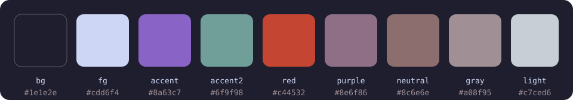

| Nombre | Color | Para qué |
| --- | --- | --- |
| bg | `#1e1e2e` | Fondos |
| fg | `#cdd6f4` | Texto |
| accent | `#8a63c7` | Borde activo, selección, botones con foco |
| accent2 | `#6f9f98` | Segundo acento, hover, enlaces |
| red | `#c44532` | Urgente, errores |
| purple | `#8e6f86` | Magenta de la terminal |
| neutral | `#8c6e6e` | Borde inactivo de la terminal, amarillo de la terminal |
| gray | `#a08f95` | Elementos inactivos, bordes de los módulos |
| light | `#c7ced6` | Texto secundario |

**Cambiar la paleta.** No hay un fichero central: cada programa tiene su propia copia de los colores. Están en `hypr/hyprland.lua` (las líneas `local bg = …`), `waybar/style.css` (`@define-color`), `kitty/kitty.conf`, `wofi/style.css` y `sddm-silent/hypr.conf`. El esquema de Qt `HyprPalette.colors` usa los mismos colores en RGB. Para cambiar un color en todas partes:

```bash
chezmoi cd
grep -rl --exclude-dir=.git 8a63c7 .                            # dónde se usa el acento
grep -rl --exclude-dir=.git 8a63c7 . | xargs sed -i 's/8a63c7/ff79c6/g'   # reemplazarlo
chezmoi apply
```

`wofi/style.css` también escribe el fondo como `rgba(30, 30, 46, 0.96)`, así que ese hay que cambiarlo a mano.

**Fuentes:** **JetBrainsMono Nerd Font** en todo, con Noto Color Emoji y Source Han Sans JP (japonés) de respaldo, definidas en `fontconfig/fonts.conf`. Sin una fuente japonesa, el texto en japonés sale en cuadros vacíos en la terminal, el navegador y el título de la ventana en waybar. Las apps que ya estaban abiertas al instalar una fuente hay que reiniciarlas para que la usen.

## Hyprland

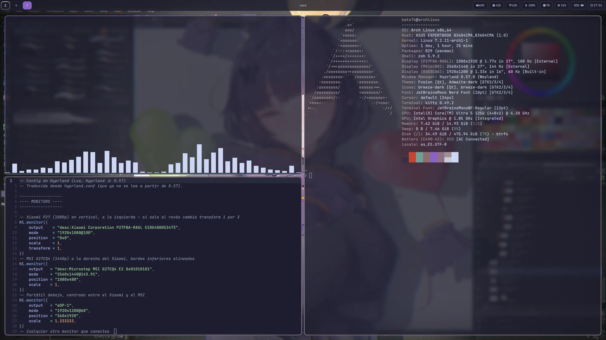

`hypr/hyprland.lua`. Desde la 0.57, Hyprland solo lee el fichero Lua y se ignora `hyprland.conf`.

**Qué está configurado**

- Distribución `dwindle`, huecos de 5 px entre ventanas y de 20 px con el borde de la pantalla, bordes de 2 px con un degradado `accent` → `accent2` y esquinas redondeadas (10 px).
- Desenfoque detrás de waybar.
- Autoarranque: hyprpaper, waybar, mako, hypridle, el agente de polkit y el script de la tapa.
- Tapa: `scripts/lid.sh` apaga la pantalla del portátil con la tapa cerrada si hay un monitor externo conectado.

**Qué cambiar para tu equipo**

- **Monitores.** Mis tres monitores se definen por su descripción (`desc:…`). Lista los tuyos con `hyprctl monitors all` y edita los bloques `hl.monitor({ … })`: `output`, `mode`, `position` y `scale`. El último bloque (`output = ""`) recoge cualquier otro monitor, así que con una sola pantalla funciona sin tocar nada.
- **Pantalla del portátil.** `scripts/lid.sh` repite el modo, la posición y la escala de `eDP-1`: mantenlo igual que su bloque `hl.monitor`.
- **Apps.** `local terminal` y `fileManager` al principio del fichero.
- **Teclado.** `kb_layout = "us"` en el bloque `input` (por ejemplo `"es"`).
- **Comprobar antes de recargar:** `Hyprland --verify-config -c ~/.config/hypr/hyprland.lua` y después `hyprctl reload`. El CI hace la misma comprobación en cada pull request. Los stubs de la API están en `/usr/share/hypr/stubs/hl.meta.lua`.

**Atajos.** `Super` es el modificador principal.

| Teclas | Acción |
| --- | --- |
| `Super + Return` | Terminal (kitty) |
| `Super + Space` | Lanzador de apps (wofi) |
| `Super + F` | Firefox |
| `Super + E` | Gestor de archivos (Thunar) |
| `Super + Backspace` | Menú de salida (wlogout) |
| `Super + Q` | Cerrar ventana |
| `Super + V` | Alternar flotante |
| `Super + H/J/K/L` | Mover el foco |
| `Super + Shift + H/J/K/L` | Mover ventana |
| `Super + Ctrl + H/J/K/L` | Redimensionar ventana |
| `Super + Tab`, luego `Super + H/J/K/L` | Intercambiar ventanas (`Esc` para salir) |
| `Super + 1…0` | Ir al escritorio |
| `Super + Shift + 1…0` | Mandar la ventana al escritorio |
| `Super + S` / `Super + Shift + S` | Scratchpad: mostrar / mandar ventana |
| `Super + M` | Salir de Hyprland |

Las teclas de medios, volumen y brillo también funcionan, incluso con la sesión bloqueada.

## Waybar

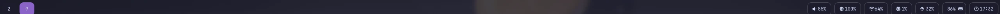

`waybar/config.jsonc` y `waybar/style.css`.

**Qué está configurado:** los escritorios a la izquierda, el título de la ventana activa en el centro y, a la derecha, volumen, brillo, Wi-Fi, Bluetooth, CPU, memoria, batería, reloj y bandeja.

Tres módulos abren un menú de wofi con un clic (scripts en `waybar/scripts/`):

- **Wi-Fi** (`wifi-menu.sh`): redes cercanas con su señal y candado, la conectada marcada. Las guardadas conectan directamente; las nuevas piden la contraseña. También enciende y apaga el Wi-Fi.
- **Bluetooth** (`bluetooth-menu.sh`): dispositivos emparejados para conectar o desconectar, encender y apagar el Bluetooth, y emparejar uno nuevo con blueman. Con un dispositivo conectado, el módulo muestra su nombre y su batería.
- **Batería** (`power-menu.sh`): los tres modos de power-profiles-daemon (rendimiento, equilibrado, ahorro) con el actual marcado.

Cada acción avisa con una notificación de mako. Cada módulo es una caja redondeada con un borde fino `gray`; el escritorio activo va en `accent` y uno urgente en `red`.

**Qué cambiar para tu equipo:** tres módulos apuntan a mi hardware.

| Módulo | Clave | Mi valor | Cómo ver el tuyo |
| --- | --- | --- | --- |
| `network` | `interface` | `wlan0` | `ip link` |
| `backlight` | `device` | `intel_backlight` | `ls /sys/class/backlight` |
| `battery` | `battery` / `adapter` | `BAT0` / `AC0` | `ls /sys/class/power_supply` |

En un PC de sobremesa sin batería ni brillo, quita esos módulos de `modules-right`. Para recargar: `pkill -SIGUSR2 waybar`.

## Pantalla de login (SDDM)

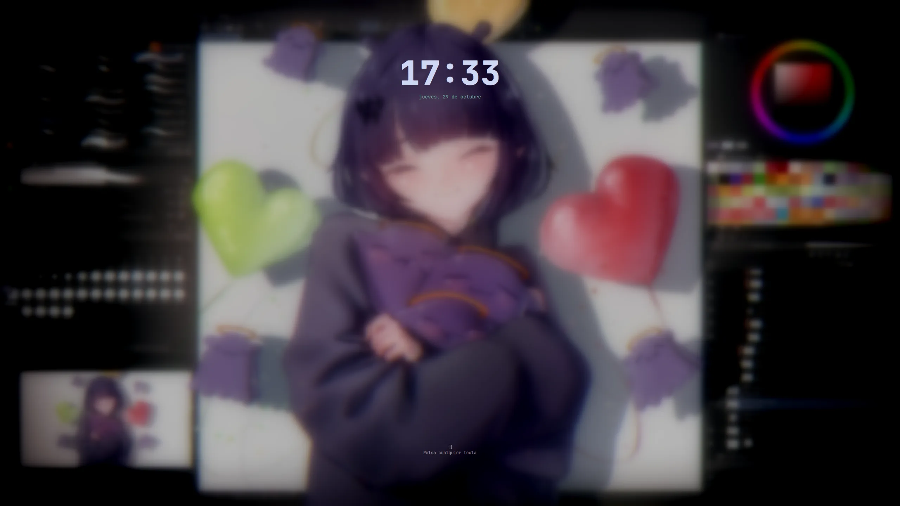

El tema [SilentSDDM](https://github.com/uiriansan/SilentSDDM) con la misma paleta y fuente. `sddm-silent/hypr.conf` tiene los ajustes del tema: wallpaper desenfocado y oscurecido, reloj `HH:mm` y la fecha en español (`dddd, d 'de' MMMM`, se cambia en `[LockScreen.Date]`). Todas las opciones están en la [wiki del tema](https://github.com/uiriansan/SilentSDDM/wiki/Customizing).

SDDM corre con su propio usuario, así que su tema no puede vivir en tu home. `install.sh` copia la config, el wallpaper y el `Xsetup` a su sitio con `sudo`:

```bash
~/.config/sddm-silent/install.sh
cd /usr/share/sddm/themes/silent && ./test.sh   # vista previa sin cerrar sesión
```

Vuelve a ejecutarlo tras actualizar `sddm-silent-theme` o cambiar el wallpaper. `Xsetup` deja el login en una sola pantalla: con la tapa cerrada ignora la del portátil, y elige el monitor de mayor resolución. No hay que cambiar nada por equipo.

## Menú de salida (wlogout)

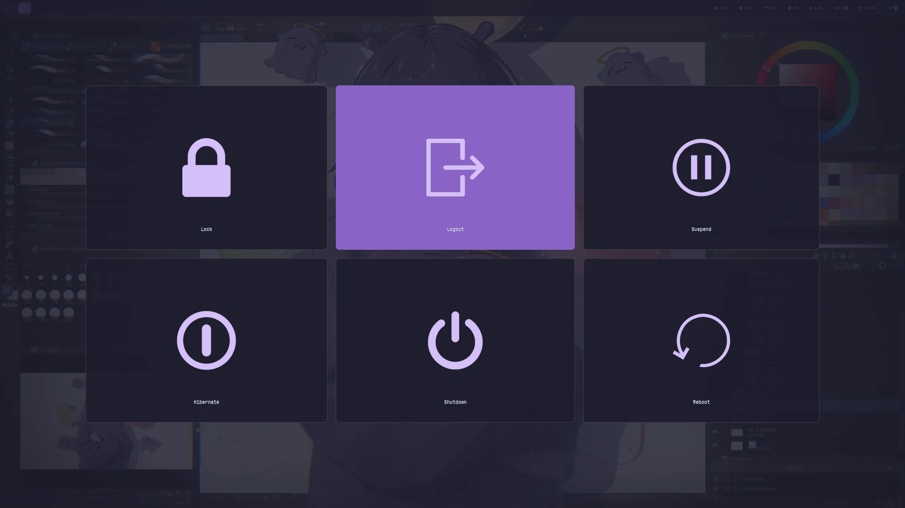

`Super + Backspace`. `wlogout/layout` define las seis acciones y su letra (`l` bloquear, `e` cerrar sesión, `u` suspender, `h` hibernar, `s` apagar, `r` reiniciar). Cerrar sesión usa `hyprshutdown` si está instalado y, si no, sale de Hyprland directamente.

`wlogout/style.css` usa la paleta: fondo `bg` translúcido, tarjetas redondeadas con un borde fino `gray` como los módulos de waybar, JetBrainsMono, y el botón con el ratón encima se pone `accent`. Solo el ratón resalta un botón: por defecto también lo hacía el foco de teclado, así que Lock parecía siempre seleccionado.

## Bloqueo e inactividad

`hypr/hyprlock.conf` tiene la misma estética que la pantalla de login: wallpaper desenfocado y oscurecido, reloj `HH:mm`, la fecha en el idioma del sistema y el campo de contraseña con el degradado de los bordes de las ventanas (`accent` → `accent2`; `red` si la contraseña es incorrecta). Se abre con el botón Lock de wlogout.

`hypr/hypridle.conf` gestiona la inactividad: bloquea a los 5 min, apaga las pantallas a los 10 (vuelven con el ratón o una tecla) y suspende a los 30. Siempre bloquea antes de suspender. Cambia los valores de `timeout` (en segundos) a tu gusto; hypridle arranca con Hyprland.

## Lanzador de apps (wofi)

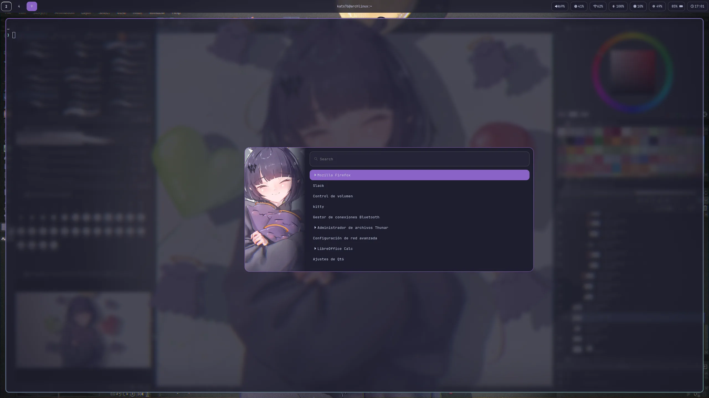

`Super + Space`. `wofi/config` fija el tamaño (560×420), la posición (centro) y la terminal para las apps de terminal; `wofi/style.css` usa la paleta, con la entrada seleccionada en `accent`.

## Visor de imágenes (swayimg)

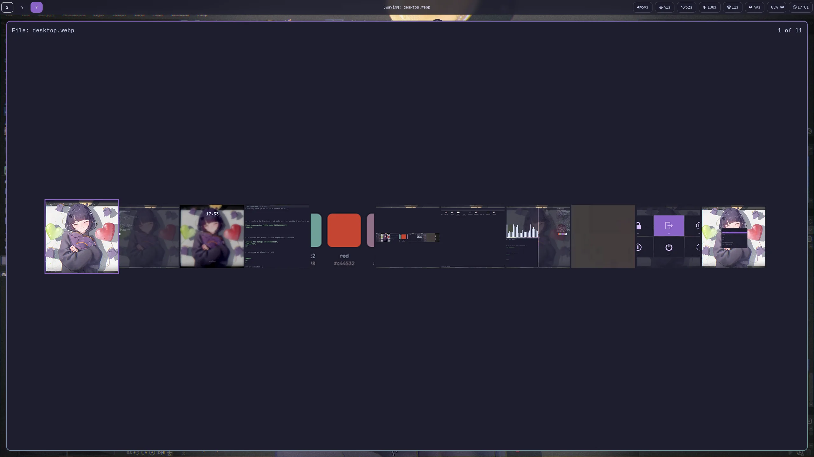

[swayimg](https://github.com/artemsen/swayimg) abre todos los tipos de imagen. `swayimg/init.lua` solo cambia el aspecto: fondo `bg`, texto `fg` en JetBrainsMono y borde `accent` en la miniatura seleccionada. Con `Enter` se pasa de una imagen a la galería y al revés. Para que sea el visor por defecto, ejecútalo una vez en un equipo nuevo:

```bash
xdg-mime default swayimg.desktop $(grep '^MimeType=' /usr/share/applications/swayimg.desktop | cut -d= -f2 | tr ';' ' ')
```

## Terminal y shell

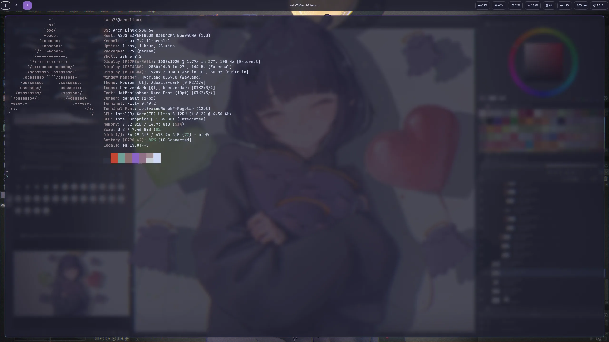

- **kitty** (`kitty/kitty.conf`): JetBrainsMono 12, fondo al 80 % de opacidad y los 16 colores de la terminal adaptados a la paleta. Ajusta `font_size` y `background_opacity` a tu gusto.
- **zsh** (`.zshrc`): Oh My Zsh con el plugin `git`, el prompt [starship](https://starship.rs) y zsh-autosuggestions. Añade `~/.local/bin` y `~/.npm-global/bin` al `PATH`.
- **mako** (`mako/config`): notificaciones centradas justo bajo el título de la ventana en waybar, con la paleta, JetBrainsMono y las mismas esquinas de 10 px que los módulos de la barra. Las normales llevan borde `accent` y se cierran a los 5 s; las de baja prioridad, `gray`; las críticas, `red`, y se quedan hasta hacer clic. Para recargar: `makoctl reload`.
- **fastfetch** usa su config por defecto; no hay fichero suyo en el repo.
- **cava** (`cava/config`) usa sus valores por defecto más algunos shaders y temas. Lee el audio de PipeWire (`method = pipewire` en `[input]`).

## Neovim

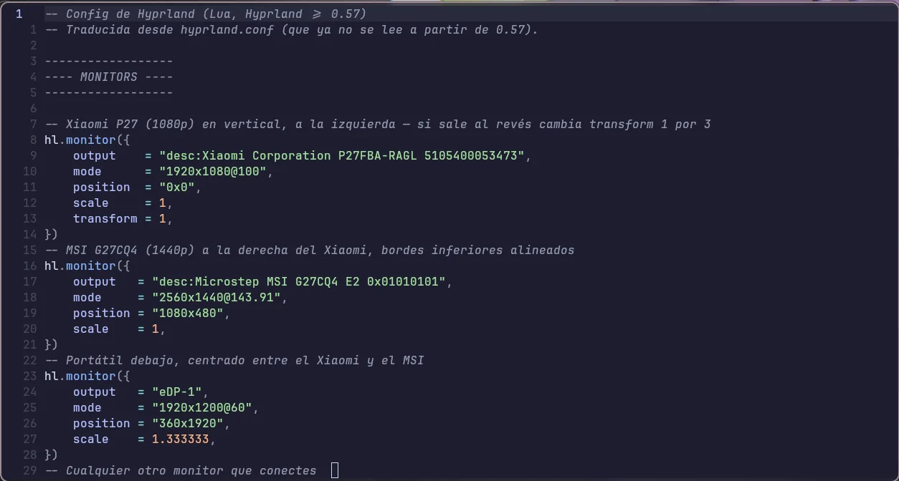

`nvim/`, una config pequeña propia, no una distribución:

- `init.lua` instala [lazy.nvim](https://github.com/folke/lazy.nvim) en el primer arranque y carga cada fichero de `lua/plugins/`.
- `lua/plugins/ui.lua`: el tema Catppuccin Mocha y los iconos de archivos.
- `lua/config/options.lua`: números de línea relativos, sangría de 2 espacios y 10 líneas de margen al hacer scroll. La tecla líder es `Espacio`.

Para añadir un plugin, crea un fichero en `lua/plugins/` que devuelva su especificación.

## Gestor de archivos y GTK

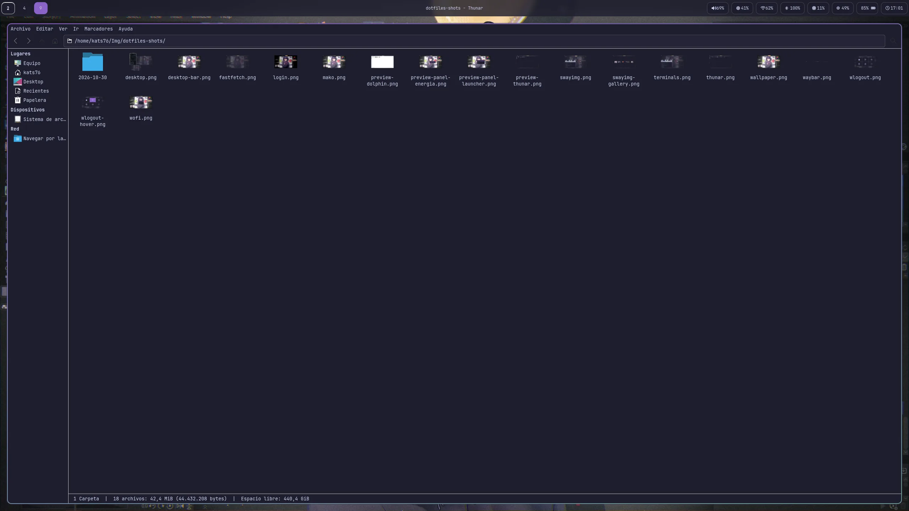

- **Thunar** es el gestor de archivos (`Super + E`). Sigue la paleta gracias a `gtk-3.0/gtk.css`, que redefine los colores de Adwaita-dark: fondo `bg`, selección `accent` y hover `accent2`. El mismo fichero colorea todas las apps GTK3 (control de volumen, Bluetooth, diálogos).
- **GTK 3/4** (`gtk-3.0/settings.ini`, `gtk-4.0/settings.ini`): Adwaita-dark, iconos breeze-dark, JetBrainsMono y modo oscuro preferido.
- En Wayland, las apps GTK leen los iconos y la fuente de gsettings, no de `settings.ini`. Ejecútalo una vez en un equipo nuevo:

  ```bash
  gsettings set org.gnome.desktop.interface icon-theme 'breeze-dark'
  gsettings set org.gnome.desktop.interface font-name 'JetBrainsMono Nerd Font 10'
  ```

- **Qt** (`qt6ct/qt6ct.conf`): estilo Fusion con el esquema de color `HyprPalette` de `~/.local/share/color-schemes/`. `hyprland.lua` fija `QT_QPA_PLATFORMTHEME=qt6ct` para que las apps Qt (como OBS) lo usen.

## Flujo de trabajo

El mismo flujo que en mis otros repos: **`dev` es para probar y `main` es lo publicado.**

1. Cada cambio empieza como una [issue](../../issues) con una propuesta y criterios de aceptación.
2. Una rama desde `dev` (`feat/…`, `fix/…`, `docs/…`, `ci/…`) y una pull request a `dev`. Conventional Commits y squash merge.
3. El workflow **Check configs** renderiza el repo con chezmoi en un home vacío y lo valida: `Hyprland --verify-config`, sintaxis Lua, shellcheck y JSON. `dev` y `main` solo aceptan cambios con el check en verde.
4. Una vez probado en la máquina real, `main` avanza hasta `dev` con fast-forward.

```bash
chezmoi cd
git switch dev && git pull
git switch -c feat/mi-cambio

# Editar, o traer cambios hechos directamente en ~
chezmoi re-add
chezmoi diff && chezmoi apply      # probar en esta máquina

git commit -am "feat: ..." && git push -u origin feat/mi-cambio
gh pr create --base dev            # "Closes #N" en la descripción

# Publicar (después de fusionar la PR en dev)
git switch main && git pull && git merge --ff-only dev && git push
git switch dev && git pull
```

Para añadir un archivo nuevo: `chezmoi add ~/.config/algo/config.toml`.

## Nunca va al repo 🔒

Credenciales y estado local. **Nunca** `chezmoi add` sobre:

- `~/.codex/auth.json`, `~/.codex/config.toml`, `~/.codex/*.sqlite*`
- `~/.claude.json`, `~/.claude/.credentials.json`, historiales y sesiones
- `~/.config/gh/`, perfiles del navegador, Slack
- `node_modules/`, logs, cachés
- Imágenes sin licencia para redistribuirlas (como el wallpaper)

Si algún día hace falta una config con secretos, se usa una plantilla de chezmoi que lea el secreto de un gestor (1Password, Bitwarden, `pass`), nunca el secreto en texto plano.

## Otras máquinas

El escritorio necesita Arch Linux, pero la config de la shell y de Neovim funciona en cualquier Linux o macOS:

```bash
brew install chezmoi gh neovim     # o el gestor de paquetes de tu distro
gh auth login
chezmoi init kats76
chezmoi diff                       # revisar qué cambiaría
chezmoi apply ~/.config/nvim ~/.zshrc
```

`chezmoi apply` con rutas solo aplica esos ficheros, así la config de Hyprland no llega a una máquina que no la usa. En Windows, usa WSL2 (`wsl --install`) y sigue los mismos pasos dentro.

## Licencia

[MIT](LICENSE)
