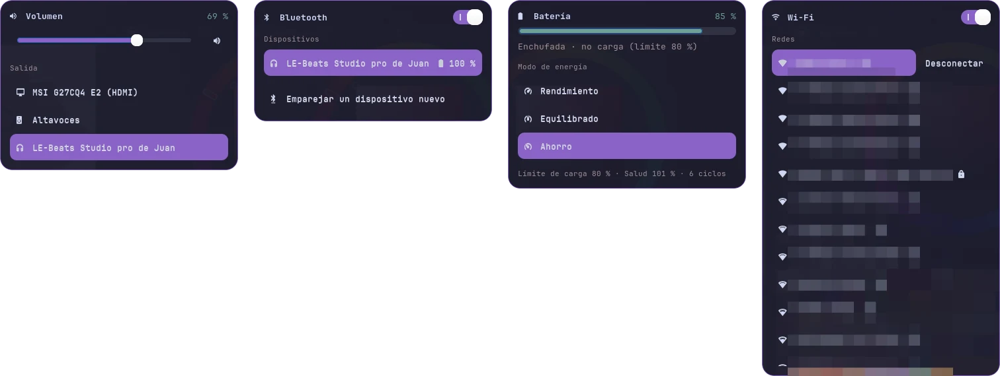
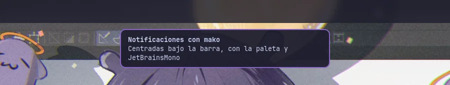

# dotfiles

[](https://github.com/kats76/dotfiles/actions/workflows/check.yml)

[Leer en español](README.es.md)

My Arch Linux + Hyprland setup, managed with [chezmoi](https://www.chezmoi.io/). One palette and one font everywhere: the window manager, the bar, the launcher, the terminal, the logout menu and the login screen.


This README is also a guide: each component has a screenshot, what is configured and what to change so it fits your machine.

- [Install](#install-arch-linux)
- [Palette and fonts](#palette-and-fonts)
- [Hyprland](#hyprland) · [Waybar](#waybar) · [Login screen](#login-screen-sddm) · [Logout menu](#logout-menu-wlogout) · [Lock screen](#lock-screen-and-idle) · [App launcher](#app-launcher-wofi) · [Image viewer](#image-viewer-swayimg) · [Terminal and shell](#terminal-and-shell) · [Neovim](#neovim) · [File manager and GTK](#file-manager-and-gtk) · [Firefox](#firefox)
- [Workflow](#workflow) · [Never in the repo](#never-in-the-repo-) · [Other machines](#other-machines)

## What's inside

| Repo path | Target on the machine | What it is |
| --- | --- | --- |
| `dot_config/hypr/` | `~/.config/hypr/` | Hyprland 0.57+ in Lua, wallpaper and the lid script |
| `dot_config/waybar/` | `~/.config/waybar/` | Top bar |
| `dot_config/sddm-silent/` | `~/.config/sddm-silent/` | Login screen (SilentSDDM theme) and its installer |
| `dot_config/wlogout/`, `wofi/`, `mako/` | `~/.config/…` | Logout menu, app launcher and notifications |
| `dot_config/kitty/`, `cava/`, `swayimg/` | `~/.config/…` | Terminal, audio visualizer and image viewer |
| `dot_config/nvim/` | `~/.config/nvim/` | Neovim with lazy.nvim and Catppuccin |
| `dot_config/fontconfig`, `gtk-3.0`, `gtk-4.0`, `qt6ct` | `~/.config/…` | Make GTK and Qt apps follow the same look |
| `dot_local/share/color-schemes/` | `~/.local/share/color-schemes/` | Qt color scheme with the palette |
| `dot_zshrc`, `dot_bashrc` | `~/.zshrc`, `~/.bashrc` | Shell |

> chezmoi naming: `dot_` = `.`, `private_` = no permissions for others, `executable_` = executable bit, `.tmpl` = template.

## Install (Arch Linux)

Do a full `sudo pacman -Syu` first: installing a Qt package on a partially upgraded system breaks SDDM.

```bash
sudo pacman -S chezmoi hyprland hyprpaper waybar mako hyprlock hypridle swayimg kitty wofi cava brightnessctl playerctl grim slurp wl-clipboard \
  ttf-jetbrains-mono-nerd noto-fonts-emoji adobe-source-han-sans-jp-fonts qt6ct thunar starship \
  zsh-autosuggestions sddm qt6-virtualkeyboard blueman power-profiles-daemon python-gobject gtk-layer-shell
yay -S wlogout sddm-silent-theme
chezmoi init kats76
chezmoi diff        # review what would change
chezmoi apply
```

Home paths are templates (`{{ .chezmoi.homeDir }}`), so another username works. Several values belong to **my** hardware (monitors, network interface, battery): each section below says which ones and how to find yours. Change them before the first login.

### Wallpaper

The wallpaper is not in this repo. Download it from [wallhaven 9oo8k1](https://wallhaven.cc/w/9oo8k1) to `~/Img/wallhaven-9oo8k1.jpg`, or use your own and change the path in four places: `hypr/hyprpaper.conf`, `hypr/hyprlock.conf`, `WALLPAPER` in `sddm-silent/install.sh` and `SOURCE` in `wofi/make-panel.sh`.

## Palette and fonts


| Name | Color | Used for |
| --- | --- | --- |
| bg | `#1e1e2e` | Backgrounds |
| fg | `#cdd6f4` | Text |
| accent | `#8a63c7` | Active border, selection, focused buttons |
| accent2 | `#6f9f98` | Second accent, hover, links |
| red | `#c44532` | Urgent, errors |
| purple | `#8e6f86` | Terminal magenta |
| neutral | `#8c6e6e` | Inactive terminal border, terminal yellow |
| gray | `#a08f95` | Inactive elements, module borders |
| light | `#c7ced6` | Secondary text |

**Change the palette.** There is no central file: each program has its own copy of the colors. They live in `hypr/hyprland.lua` (the `local bg = …` lines), `waybar/style.css` (`@define-color`), `kitty/kitty.conf`, `wofi/style.css` and `sddm-silent/hypr.conf`. The Qt scheme `HyprPalette.colors` uses the same colors in RGB. To swap one color everywhere:

```bash
chezmoi cd
grep -rl --exclude-dir=.git 8a63c7 .                            # where the accent is used
grep -rl --exclude-dir=.git 8a63c7 . | xargs sed -i 's/8a63c7/ff79c6/g'   # replace it
chezmoi apply
```

`wofi/style.css` also writes the background as `rgba(30, 30, 46, 0.96)`, so change that one by hand.

**Fonts:** **JetBrainsMono Nerd Font** everywhere, with Noto Color Emoji and Source Han Sans JP (Japanese) as fallbacks, set in `fontconfig/fonts.conf`. Without a Japanese font, Japanese text shows as empty squares in the terminal, the browser and the window title in waybar. Apps that were already open when you install a font need a restart to use it.

## Hyprland


`hypr/hyprland.lua`. Since 0.57 Hyprland only reads the Lua file; `hyprland.conf` is ignored.

**What is configured**

- `dwindle` layout, gaps of 5 px between windows and 20 px to the screen edge, 2 px borders with an `accent` → `accent2` gradient and rounded corners (10 px).
- Blur behind waybar.
- Autostart: hyprpaper, waybar, mako, hypridle, the polkit agent and the lid script.
- Lid: `scripts/lid.sh` turns the laptop panel off when the lid is closed and an external monitor is connected.

**Change for your machine**

- **Monitors.** My three monitors are defined by their description (`desc:…`). List yours with `hyprctl monitors all` and edit the `hl.monitor({ … })` blocks: `output`, `mode`, `position` and `scale`. The last block (`output = ""`) catches any other monitor, so a single screen works without touching anything.
- **Laptop panel.** `scripts/lid.sh` repeats the `eDP-1` mode, position and scale: keep it in sync with its `hl.monitor` block.
- **Apps.** `local terminal` and `fileManager` at the top of the file.
- **Keyboard.** `kb_layout = "us"` in the `input` block (for example `"es"`).
- **Check before reloading:** `Hyprland --verify-config -c ~/.config/hypr/hyprland.lua`, then `hyprctl reload`. CI runs the same check on every pull request. API stubs live in `/usr/share/hypr/stubs/hl.meta.lua`.

**Keybindings.** `Super` is the main modifier.

| Keys | Action |
| --- | --- |
| `Super + Return` | Terminal (kitty) |
| `Super + Space` | App launcher (wofi) |
| `Super + F` | Firefox |
| `Super + E` | File manager (Thunar) |
| `Super + Backspace` | Logout menu (wlogout) |
| `Super + Q` | Close window |
| `Super + V` | Toggle floating |
| `Super + H/J/K/L` | Move focus |
| `Super + Shift + H/J/K/L` | Move window |
| `Super + Ctrl + H/J/K/L` | Resize window |
| `Super + Tab`, then `Super + H/J/K/L` | Swap windows (`Esc` to leave) |
| `Super + 1…0` | Go to workspace |
| `Super + Shift + 1…0` | Send window to workspace |
| `Super + S` / `Super + Shift + S` | Scratchpad: show / send window |
| `Super + M` | Exit Hyprland |
| `Print` | Screenshot of an area to the clipboard |
| `Super + Print` | Screenshot of an area, saved to `~/Img/Screenshots` and copied |

Media, volume and brightness keys work too, even on the lock screen. Screenshots use `hypr/scripts/screenshot.sh` (grim and slurp); `Esc` cancels the selection.

## Waybar


`waybar/config.jsonc` and `waybar/style.css`.

**What is configured:** workspaces on the left, the active window title in the center, and on the right volume, brightness, Wi-Fi, Bluetooth, CPU, memory, battery, clock and tray.

Four modules open a small panel with a click (scripts in `waybar/scripts/`). The panels come out of their button, use the palette and fit any monitor (also the vertical one):



- **Volume** (`sound-panel.py`): volume slider, mute button and the audio outputs (speakers, the monitor over HDMI, Bluetooth headphones). Picking an output moves what is already playing to it. HDMI outputs without a screen are hidden. The mouse wheel over the icon still changes the volume.
- **Wi-Fi** (`wifi-panel.py`): opens instantly with the networks the system already knows and scans in the background. Switch to turn Wi-Fi on and off, the connected network on top with a Disconnect button, and the password of a new network is typed inside the panel.
- **Bluetooth** (`bluetooth-panel.py`): power switch, paired devices with their battery, connect or disconnect with a click, and pair a new one with blueman. In the bar the module only shows the icon and the headphones battery, so it fits on narrow monitors; the name is in the tooltip.
- **Battery** (`battery-panel.py`): percentage and charge bar (red below 20 %), the state in words (charging with the time until full, on battery with the time left, or plugged in and stopped by the charge limit), the three power-profiles-daemon modes as buttons, and at the bottom the charge limit, health and cycles. It updates itself while open.

The four panels share `waybar/scripts/panel.py`: position under the button, size, colors, closing (`Esc`, moving the mouse away or another click on the same button) and only one panel at a time; clicking another button switches panels. They are Python with GTK 3 and gtk-layer-shell. Every action shows a mako notification when something fails. Each module is a rounded box with a thin `gray` border; the active workspace is `accent` and an urgent one is `red`.

**Change for your machine:** three modules point to my hardware.

| Module | Key | My value | Find yours |
| --- | --- | --- | --- |
| `network` | `interface` | `wlan0` | `ip link` |
| `backlight` | `device` | `intel_backlight` | `ls /sys/class/backlight` |
| `battery` | `battery` / `adapter` | `BAT0` / `AC0` | `ls /sys/class/power_supply` |

On a desktop PC without a battery or backlight, remove those modules from `modules-right`. Reload with `pkill -SIGUSR2 waybar`.

## Login screen (SDDM)


The [SilentSDDM](https://github.com/uiriansan/SilentSDDM) theme with the same palette and font. `sddm-silent/hypr.conf` holds the theme settings: blurred and darkened wallpaper, `HH:mm` clock and the date in Spanish (`dddd, d 'de' MMMM`, change it in `[LockScreen.Date]`). Every option is documented in the [theme wiki](https://github.com/uiriansan/SilentSDDM/wiki/Customizing).

SDDM runs as its own user, so its theme cannot live in your home. `install.sh` copies the config, the wallpaper and `Xsetup` into place with `sudo`:

```bash
~/.config/sddm-silent/install.sh
cd /usr/share/sddm/themes/silent && ./test.sh   # preview without logging out
```

Run it again after updating `sddm-silent-theme` or changing the wallpaper. `Xsetup` keeps the login on a single screen: with the lid closed it ignores the laptop panel, and it picks the monitor with the highest resolution. It needs nothing per machine.

## Logout menu (wlogout)


`Super + Backspace`. `wlogout/layout` sets the six actions and their letter (`l` lock, `e` logout, `u` suspend, `h` hibernate, `s` shutdown, `r` reboot). Logout uses `hyprshutdown` if it is installed, and otherwise exits Hyprland directly.

`wlogout/style.css` uses the palette: translucent `bg` background, rounded cards with a thin `gray` border like the waybar modules, JetBrainsMono, and the button under the mouse turns `accent`. Only the mouse highlights a button: by default the keyboard focus did too, so Lock always looked selected.

## Lock screen and idle

`hypr/hyprlock.conf` uses the same look as the login screen: blurred and darkened wallpaper, `HH:mm` clock, the date in the system language and a password field with the window border gradient (`accent` → `accent2`; `red` on a wrong password). The Lock button of wlogout opens it.

`hypr/hypridle.conf` handles inactivity: lock after 5 min, screens off after 10 (they come back with the mouse or a key) and suspend after 30. It always locks before suspending. Change the `timeout` values (in seconds) to taste; hypridle starts with Hyprland.

## App launcher (wofi)


`Super + Space`. `wofi/config` sets the size (560×420), the position (center) and the terminal for terminal apps; `wofi/style.css` uses the palette, with the selected entry in `accent`.

The launcher always opens through `wofi/menu.sh`:

- **One launcher at a time.** A lock (`flock`, in `wofi/lib.sh`) ignores extra presses while it is open.
- **Illustration panel.** When the active workspace has windows, a crop of the wallpaper appears on the left (`wofi/style-panel.css`, added on top of `style.css`). On an empty workspace the wallpaper is already visible, so the menu opens without it.

**Change the panel image:** edit `SOURCE` (the image) and `CROP` (the area, `WIDTHxHEIGHT+X+Y`; empty for an automatic center crop) at the top of `wofi/make-panel.sh`, then run it:

```bash
~/.config/wofi/make-panel.sh
```

It writes `~/.config/wofi/panel.png`, which is not in the repo (like the wallpaper). Without the source image, the launcher simply opens without the panel.

## Image viewer (swayimg)


[swayimg](https://github.com/artemsen/swayimg) opens every image type. `swayimg/init.lua` only changes the look: `bg` background, `fg` text in JetBrainsMono and the `accent` border on the selected thumbnail. Press `Enter` to switch between a single image and the gallery. Make it the default viewer once on a new machine:

```bash
xdg-mime default swayimg.desktop $(grep '^MimeType=' /usr/share/applications/swayimg.desktop | cut -d= -f2 | tr ';' ' ')
```

## Terminal and shell


- **kitty** (`kitty/kitty.conf`): JetBrainsMono 12, 80% background opacity and the 16 terminal colors mapped to the palette. Change `font_size` and `background_opacity` to taste.
- **zsh** (`.zshrc`): Oh My Zsh with the `git` plugin, the [starship](https://starship.rs) prompt and zsh-autosuggestions. `~/.local/bin` and `~/.npm-global/bin` are added to `PATH`.
- **mako** (`mako/config`): notifications centered right under the window title in waybar, with the palette, JetBrainsMono and the same 10 px corners as the bar modules. Normal ones have an `accent` border and close after 5 s, low priority `gray`, critical `red` and they stay until clicked. Reload with `makoctl reload`.
- **fastfetch** runs with its default config; there is no file for it in this repo.
- **cava** (`cava/config`) uses its defaults plus a few shaders and themes. It reads the audio from PipeWire (`method = pipewire` in `[input]`).



## Neovim


`nvim/`, a small config of my own, not a distribution:

- `init.lua` installs [lazy.nvim](https://github.com/folke/lazy.nvim) on first start and loads every file in `lua/plugins/`.
- `lua/plugins/ui.lua`: the Catppuccin Mocha theme and file icons.
- `lua/config/options.lua`: relative line numbers, 2-space indent, 10 lines of scroll margin. The leader key is `Space`.

Add a plugin by creating a file in `lua/plugins/` that returns its spec.

## File manager and GTK


- **Thunar** is the file manager (`Super + E`). It follows the palette through `gtk-3.0/gtk.css`, which redefines the Adwaita-dark colors: `bg` background, `accent` selection and `accent2` hover. The same file colors every GTK3 app (volume control, Bluetooth, dialogs).
- **GTK 3/4** (`gtk-3.0/settings.ini`, `gtk-4.0/settings.ini`): Adwaita-dark, breeze-dark icons, JetBrainsMono and dark mode preferred.
- On Wayland, GTK apps read the icons and the font from gsettings, not from `settings.ini`. The last line leaves only the close button in apps that draw their own title bar, like Firefox: in a tiling window manager, minimize and maximize do nothing. Run this once on a new machine:

  ```bash
  gsettings set org.gnome.desktop.interface icon-theme 'breeze-dark'
  gsettings set org.gnome.desktop.interface font-name 'JetBrainsMono Nerd Font 10'
  gsettings set org.gnome.desktop.wm.preferences button-layout ':close'
  ```

- **Qt** (`qt6ct/qt6ct.conf`): Fusion style with the `HyprPalette` color scheme from `~/.local/share/color-schemes/`. `hyprland.lua` sets `QT_QPA_PLATFORMTHEME=qt6ct` so Qt apps (like OBS) use it.

## Firefox

`firefox/hypr-palette/` is a Firefox theme with the palette: `bg` window, selected tab in `accent` like the active workspace in waybar, `fg` text, `accent2` hover, and menus and address bar to match. Private windows keep Firefox's own purple design, so they still stand out.

Firefox only installs themes signed by Mozilla, so it has to be signed once (free, and as "unlisted" it does not appear in the store):

1. Package it: `cd ~/.local/share/chezmoi/firefox/hypr-palette && bsdtar -a -cf ~/hypr-palette.zip manifest.json`
2. **Preview (optional):** in `about:debugging#/runtime/this-firefox`, *Load Temporary Add-on…* and pick `manifest.json`. It goes away when Firefox closes.
3. **Sign:** at [addons.mozilla.org/developers](https://addons.mozilla.org/developers/addon/submit/distribution), choose *On your own*, upload `hypr-palette.zip` and wait for the automatic review (a few minutes).
4. **Install:** download the signed `.xpi` from the version page and open it with Firefox.

To change a color, edit `manifest.json`, raise `version` and sign it again.

## Workflow

Same flow as my other repos: **`dev` is for testing, `main` is what gets published.**

1. Every change starts as an [issue](../../issues) with a proposal and acceptance criteria.
2. A branch off `dev` (`feat/…`, `fix/…`, `docs/…`, `ci/…`) and a pull request to `dev`. Conventional Commits, squash merge.
3. The **Check configs** workflow renders the repo with chezmoi into an empty home and validates it: `Hyprland --verify-config`, Lua and Python syntax, shellcheck and JSON. `dev` and `main` only accept changes with the check green.
4. Once tested on the real machine, `main` is fast-forwarded to `dev`.

```bash
chezmoi cd
git switch dev && git pull
git switch -c feat/my-change

# Edit, or bring in changes made directly in ~
chezmoi re-add
chezmoi diff && chezmoi apply      # test on this machine

git commit -am "feat: ..." && git push -u origin feat/my-change
gh pr create --base dev            # "Closes #N" in the description

# Publish (after the PR is merged into dev)
git switch main && git pull && git merge --ff-only dev && git push
git switch dev && git pull
```

Add a new file with `chezmoi add ~/.config/something/config.toml`.

## Never in the repo 🔒

Credentials and local state. **Never** `chezmoi add` on:

- `~/.codex/auth.json`, `~/.codex/config.toml`, `~/.codex/*.sqlite*`
- `~/.claude.json`, `~/.claude/.credentials.json`, histories and sessions
- `~/.config/gh/`, browser profiles, Slack
- `node_modules/`, logs, caches
- Images without a license to redistribute them (like the wallpaper)

If a config ever needs secrets, it uses a chezmoi template that reads the secret from a password manager (1Password, Bitwarden, `pass`), never the secret in plain text.

## Other machines

The desktop needs Arch Linux, but the shell and Neovim configs work on any Linux or macOS machine:

```bash
brew install chezmoi gh neovim     # or your distro's package manager
gh auth login
chezmoi init kats76
chezmoi diff                       # review what would change
chezmoi apply ~/.config/nvim ~/.zshrc
```

`chezmoi apply` with paths only applies those files, so the Hyprland configs stay out of a machine that does not use them. On Windows, use WSL2 (`wsl --install`) and follow the same steps inside it.

## License

[MIT](LICENSE)
